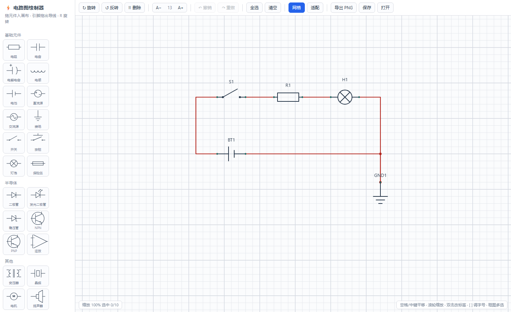

# 电路图绘制器

一个**单文件、零依赖**的浏览器端电路图编辑器。双击 `电路图绘制器.html` 就能用，不需要装环境、不需要联网、不需要构建。



---

## 快速开始

1. 双击 `电路图绘制器.html`（Chrome / Edge / Firefox 均可）
2. 从左侧元件库把元件**拖到画布**上
3. 鼠标移到元件的**引脚小圆点**上，按住拖到另一个引脚松手 —— 导线自动生成并按引脚方向走线
4. 按 `R` 转向、双击写字、框选后整体移动
5. `Ctrl+Z` 后悔，`Ctrl+S` 存成 `.json`

打开时画布上已经放了一个示例电路（电池 → 开关 → 电阻 → 灯泡 → 接地），可以直接删掉或照着重画。

---

## 操作速查

### 鼠标

| 操作 | 效果 |
| --- | --- |
| 从左侧库拖到画布 | 放置元件（自动吸附到网格） |
| 双击库里的缩略图 | 直接放到视图中央 |
| **在引脚上**按住拖动 | 拉出导线；松手落在另一个引脚/端子上即完成连接 |
| 在元件本体上按住拖动 | 移动该元件（已选中的对象会一起移动） |
| 在空白处按住拖动 | 橡皮筋**框选**（`Shift` 追加选择） |
| `Shift` + 点击对象 | 加入 / 移出选择集 |
| 双击对象 | 就地编辑它的文字标签 |
| 中键拖动 / `空格` + 拖动 | 平移画布 |
| 滚轮 | 缩放画布 |
| `Ctrl` / `Alt` + 滚轮 | 调整**选中对象**的标签字号 |

### 键盘

| 按键 | 效果 |
| --- | --- |
| `R` / `Shift+R` | 顺时针 / 逆时针旋转 90° |
| `Delete` / `Backspace` | 删除选中对象 |
| `Ctrl+Z` / `Ctrl+Y` | 撤销 / 重做 |
| `Ctrl+A` | 全选 |
| `Ctrl+D` | 复制选中对象（偏移 2 格） |
| `Ctrl+S` | 保存为 JSON |
| `F2` | 编辑选中对象的标签 |
| `↑` `↓` `←` `→` | 按格微移 |
| `[` `]`（或 `-` `=`） | 标签字号 减小 / 增大 |
| `Esc` | 取消选择 |
| `空格` | 按住进入平移模式 |

### 工具栏

`↻ 旋转` `↺ 反转` `🗑 删除` ｜ `A− 13 A+` ｜ `↶ 撤销` `↷ 重做` ｜ `全选` `清空` ｜ `网格` `适配` ｜ `导出 PNG` `保存` `打开`

字号控件的规则：

- **有选中对象** → 调整这些对象的标签字号
- **没选中对象** → 调整**新建对象**的默认字号
- **按住 `Shift` 点击** → 应用到画布上全部对象

---

## 元件库

共 25 项，分四组（缩略图就是真实的绘制结果，和画布上看到的完全一致）：

| 分组 | 元件 |
| --- | --- |
| 基础元件 | 电阻、电容、电解电容、电感、电池、直流源、交流源、接地、开关、按钮、灯泡、保险丝 |
| 半导体 | 二极管、发光二极管、稳压管、NPN 三极管、PNP 三极管、运放 |
| 其他 | 变压器、晶振、电机、扬声器、电流表、电压表 |
| 连接 | **导线端点**（下文的「端子」对象） |

每个元件的引脚坐标都是整数格，所以无论怎么转向，引脚始终落在网格点上。

---

## 核心机制

### 1. 一切吸附到网格

画布网格 20px（`const G = 20`），坐标在写入时统一取 `Math.round(v / G) * G`。所以**元件位置、引脚坐标、旋转后的落点，永远都能对上格**，这也是导线能整齐走线的前提。缩放画布不影响网格吸附，只是看得更清楚。

### 2. 导线是「端点引用」，不是坐标

导线对象里**不存任何坐标**，只记录两端挂在谁的哪个引脚上：

```js
{ kind:'wire', id:'w1', label:'', fs:13,
  a: { item:'e3', pin:1 },      // 挂在元件 e3 的 1 号引脚
  b: { item:'p2', pin:0 } }     // 挂在端子 p2 上
```

由此得到几个自然的好处：

- 移动元件 → 导线自动跟随重画，**不会拉断**
- 旋转元件 → 导线端点跟着转，路径重新计算
- 删除元件 → 挂在它上面的导线自动清理，不留悬空引用
- 复制元件 → 复制出的元件与复制出的导线依然连在一起

### 3. 走线规则：沿引脚原方向出去，到相交为止

每个引脚都有一个「朝外方向」。导线从两端引脚各自的朝外方向出发，按下面的优先级求解：

1. **正交**（一端水平、一端垂直）→ 取两条方向线的交点，一个拐点直达
2. **相向水平或相向垂直** → 走中点折线，视觉上就是两点头对头接上
3. **同向 / 背对背 / 共线** → 各自沿自身方向外扩 3 格后绕行，保证两端仍然从正确的一侧进出

也就是说，**96 组（4×4 方向 × 6 种相对位置）穷举测试全部满足「出发方向 = 引脚方向、接入方向 = 引脚反方向」，不会出现导线倒着插进引脚的情况。

交叉处还会自动判定接头：一条导线的端点落在另一条导线内部（T 型）会画实心节点；纯十字交叉不画（视为不连接），符合电路图习惯。

### 4. 端子：独立的带方向端点

「连接」组里的**导线端点**是一个独立对象，只有一个带方向的引脚，可以：

- 自由摆放、`R` 键改朝向、框选、删除
- 单独设标签与字号（例如 `VCC`、`OUT`、`TP1`）
- 作为导线的落点，用来表示引出线、测试点或到其他图纸的接线

### 5. 撤销

整图快照栈（JSON），上限 120 步。拖动、旋转、连线、删除、改标签、改字号、导入、清空**全部可回退**。

一个实现上的坑值得记一笔：拖动时必须在**写完坐标之前**拍快照，否则撤销只能恢复成「拖动之后」的状态。代码里是先算落点、确认有变化再拍快照、最后落位。

### 6. 标签

- 元件、导线、端子都有各自的文字标签，双击就地编辑，`F2` 也行
- 每个标签的**字号独立**（8–48px），标签与元件之间的间距会随字号按比例让开
- 标签始终水平绘制，不随元件旋转而倾倒；导线标签带白色衬底，压线也看得清

---

## 文件与数据

### 目录结构

```text
├── 电路图绘制器.html     编辑器本体：单文件、零依赖，全部程序都在这里
├── README.md             本文件
├── screenshot.png        README 里引用的界面截图
└── test/
    └── regress.js        回归测试（Node 里跑，不需要浏览器）
```

### 导出 PNG

按**内容的包围盒**自动裁剪并留 40px 白边，2 倍分辨率输出，不含网格与选中框。适合直接贴进实验报告。

### 保存 / 打开 JSON

`.json` 是纯文本，结构如下（可直接看懂、也能手改）：

```json
{
  "v": 1,
  "nextId": 12,
  "counters": { "resistor": 1, "P": 1, "battery": 1 },
  "items": [
    { "kind": "part", "id": "e1", "type": "battery",   "x": 320, "y": 300, "rot": 0, "label": "BT1", "fs": 13 },
    { "kind": "part", "id": "e2", "type": "resistor",  "x": 480, "y": 140, "rot": 0, "label": "R1",  "fs": 13 },
    { "kind": "port", "id": "p1", "x": 400, "y": 400,  "rot": 0, "label": "P1",  "fs": 13 },
    { "kind": "wire", "id": "w1", "label": "OUT", "fs": 13,
      "a": { "item": "e2", "pin": 1 },
      "b": { "item": "p1", "pin": 0 } }
  ]
}
```

字段说明：

| 字段 | 含义 |
| --- | --- |
| `kind` | `part` 元件 / `port` 端子 / `wire` 导线 |
| `type` | 元件的种类名，见下表 |
| `x` `y` | 世界坐标，**永远是 20 的整数倍** |
| `rot` | 旋转角，取 `0 / 90 / 180 / 270` |
| `label` | 显示文字，空字符串则不显示 |
| `fs` | 该标签的字号（8–48），旧文件缺这个字段时自动回退默认值 |
| `a` `b` | 导线两端：`{ item: 对象id, pin: 引脚序号 }` |

元件 `type` 取值：

```
resistor capacitor ecap inductor battery dcsrc acsrc gnd
sw button lamp fuse
diode led zener npn pnp opamp
transformer xtal motor spk ammeter voltmeter
```

---

## 代码结构

整个程序是一个 1500 余行的单文件 HTML，内部分区清晰：

| 区域 | 内容 |
| --- | --- |
| `PARTS` | 元件库。每个元件 = 引脚表 `pins` + 包围盒 `box` + 绘制函数 `draw` |
| `geometric helpers` | `snap` / `rotPt` / `segDist` 等纯几何函数 |
| `routePoints()` | **布线算法**（唯一一处决定导线怎么拐弯的地方） |
| `pinsOf()` / `resolveEnd()` | 引脚世界坐标与方向解析，导线端点解析 |
| `render()` | 全量重绘：网格 → 导线 → 接头 → 元件 → 选中态 → 框选/预览 |
| `snapshot()` / `undo()` | 快照式撤销 |
| 事件段 | 指针、滚轮、拖放、键盘、标签编辑框 |

渲染用 Canvas 2D，按 `devicePixelRatio` 适配高分屏；线宽与字号统一除以当前缩放，因此**缩放画布时线条粗细与文字大小保持稳定**，不会糊。

---

## 扩展

### 加一个新元件

在 `PARTS` 里加一条即可，三样东西：

```js
motor:{                       // 内部名称
  name:'电机',                // 库里的显示名
  def:'M',                    // 默认标签前缀（自动编号成 M1、M2…）
  box:[-1.7,-1.7,1.7,1.7],    // 包围盒，单位「格」，用于命中测试与标签定位
  pins:[[-2,0,-1,0],[2,0,1,0]],  // [x格, y格, 朝外方向x, 朝外方向y]
  draw(c){                    // 已 translate 到元件中心，单位是像素
    L(c,-2*G,0,-1*G,0); L(c,1*G,0,2*G,0);
    CIR(c,0,0,1*G);
    TXT(c,'M',0,0,16,'700');
  }
}
```

再把它的名字加进 `GROUPS` 的某个分组，缩略图会自动用同一套绘制代码生成。

### 改网格大小

改文件顶部的 `const G = 20`，吸附、绘制、命中、布线全部联动。注意元件引脚坐标是以「格」为单位的整数，所以换网格不会让元件变形。

### 改走线风格

只需要动 `routePoints()`。想改成直角优先、45° 斜线、或者总是绕最短路，都在这一个函数里。

### 命令行调试接口

页面把内部对象挂在 `window.CircuitSketch` 上，可以在 DevTools 控制台里直接操作：

```js
CircuitSketch.state.items            // 当前所有对象
CircuitSketch.rotateSelection(1)     // 旋转选中
CircuitSketch.setFontSize(20, true)  // 全部对象字号设为 20
CircuitSketch.fitView()              // 缩放适配
CircuitSketch._geo.routePoints({x:0,y:0},{x:1,y:0},{x:200,y:100},{x:0,y:-1})  // 试算走线
```

---

## 已知限制

- **纯绘图工具，不做电气仿真**：没有网表、没有连通性检查、不会提示短路。它画的是图，不是电路。
- **极端摆位会绕远**：两个引脚「背对背」或者共线同向时，为了让导线仍然从正确的一侧进出，会外扩绕行一段，不会硬拉一条直线。这是刻意的取舍。
- **标签字号不随画布缩放变化**（与线宽一致，保持屏幕恒定）。若希望标签像图纸一样跟着缩放，需要把元件标签与 `drawWireLabel()` 里的 `fs / view.z` 改成固定的世界尺寸。
- **不处理元件内部文字**（电表的 `A`/`V`、电机的 `M`、运放的 `+`/`−`）的字号 —— 它们属于符号本身，只随元件旋转，不随标签字号变化。
- 没有多页 / 图层 / 元件对齐辅助线；元件旋转只有 90° 的整数倍。

---

## 开发与验证

改动之后建议跑一遍回归。核心逻辑（布线几何、网格吸附、导线跟随、删除清理、撤销栈、字号）**不依赖真实浏览器**，`test/regress.js` 用最小 DOM 桩把 HTML 里的脚本直接加载进 Node 执行：

```bash
node test/regress.js
```

```
✅ 全部通过 37 项
```

脚本覆盖的边界情形包括：撤销能精确恢复拖动前后的坐标、字号 8 与 48 的钳制、旧版无 `fs` 字段的数据兼容、重复连接同一对引脚自动去重、删除元件时挂载导线的连带清理、`Ctrl+滚轮` 与画布缩放互不干扰、以及旋转 / 移动后导线端点仍然满足方向约束（其中布线方向约束另做了 4×4 方向 × 6 种相对位置 = 96 组穷举）。

界面的视觉效果则用无头浏览器截图逐元件核对：

```bash
msedge --headless=new --disable-gpu --window-size=1440,880 \
       --screenshot=screenshot.png "file:///<绝对路径>/电路图绘制器.html"
```

---

## 授权

自用工具，随意取用修改。